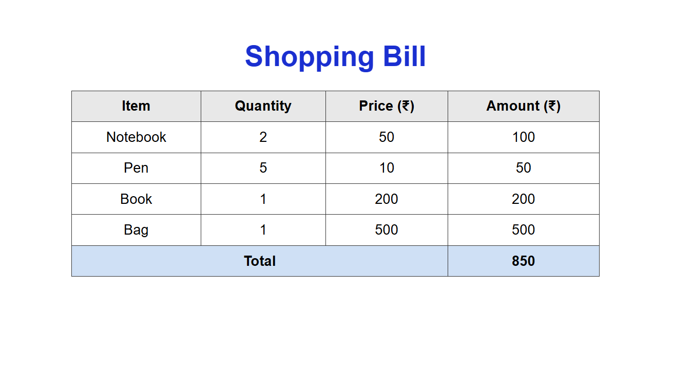

# Shopping Bill Table

A simple HTML page that displays a shopping bill as a table, with the amount for each item and a grand total.

## Screenshot



## Features

- Heading: **Shopping Bill**
- Table columns: Item, Quantity, Price (₹), Amount (₹)
- Amount for each row = Quantity × Price
- Grand total shown in the last row
- Semantic table structure using `<thead>`, `<tbody>` and `<tfoot>`
- Total row label merged across three columns using `colspan="3"`

## Data

| Item     | Quantity | Price (₹) | Amount (₹) |
|----------|----------|-----------|------------|
| Notebook | 2        | 50        | 100        |
| Pen      | 5        | 10        | 50         |
| Book     | 1        | 200       | 200        |
| Bag      | 1        | 500       | 500        |
| **Total**|          |           | **850**    |

## HTML Concepts Used

- `<table>`
- `<thead>`
- `<tbody>`
- `<tfoot>`
- `colspan`

## How to Run

1. Clone the repository:
   ```
   git clone https://github.com/taniyasharma1010/shopping-bill.git
   ```
2. Open the folder and double-click `index.html` to view it in any browser.

## Project Structure

```
shopping-bill/
├── index.html
├── home.png
└── README.md
```

## Author

[taniyasharma1010](https://github.com/taniyasharma1010)
